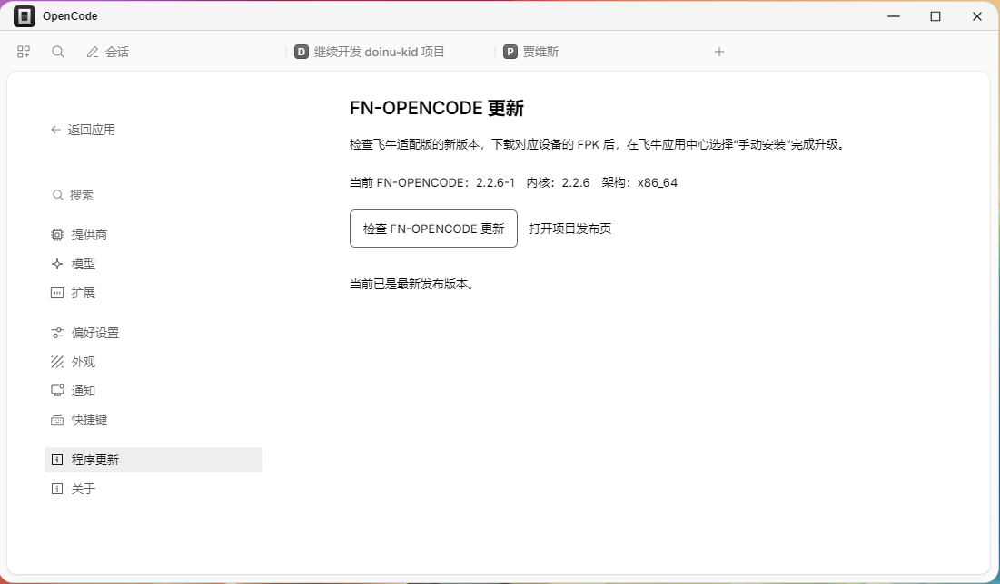

# OpenCode for fnOS


在飞牛 NAS 上使用 OpenCode，让 AI 直接参与项目开发、文件编辑和终端操作。

本项目将官方 OpenCode Web 服务适配为 fnOS 原生 FPK 应用，可从飞牛桌面直接打开，无需 Docker。由 **HANSHOJIN** 维护，与 OpenCode 官方团队无隶属关系。

[直接下载 FPK 安装包](https://github.com/HANSHOJIN/FN-OPENCODE/releases/download/v2.2.2-1/OpenCode-fnOS-2.2.2-1-x86_64.fpk) · [版本记录](https://github.com/HANSHOJIN/FN-OPENCODE/releases) · [问题反馈](https://github.com/HANSHOJIN/FN-OPENCODE/issues) · [OpenCode 上游](https://github.com/anomalyco/opencode)

> 当前版本：[2.2.2-1](https://github.com/HANSHOJIN/FN-OPENCODE/releases/tag/v2.2.2-1)，提供 x86_64 与 ARM64 安装包。

| 安装包 | 验证状态 | 下载 |
| --- | --- | --- |
| x86_64 | NAS 隔离运行与浏览器检查通过 | [FPK](https://github.com/HANSHOJIN/FN-OPENCODE/releases/download/v2.2.2-1/OpenCode-fnOS-2.2.2-1-x86_64.fpk) |
| ARM64 | 本版通过打包与架构检查 | [FPK](https://github.com/HANSHOJIN/FN-OPENCODE/releases/download/v2.2.2-1/OpenCode-fnOS-2.2.2-1-arm64.fpk) |



## 功能

以下为 2.2.2 系列的使用说明。

- **飞牛桌面集成**：桌面窗口、深浅色标题栏与紧凑布局。
- **AI 编程**：使用 OpenCode 的会话、项目、文件操作和终端功能。
- **供应商连接**：使用官方 API Key 和 OpenCode Console / Go 账号授权。
- **官方设置菜单**：提供偏好设置、外观、通知、项目、工作区、扩展及关于页面。
- **自动审批**：使用官方默认自动审批功能，项目可以单独设置权限。
- **项目记忆**：NAS 保留项目目录；新浏览器或手机 WebView 没有本地记录时，可恢复已保存的项目。默认工作目录为共享目录下的“默认项目”。
- **数据持久化**：共享目录保存项目，应用数据目录保存配置、授权信息和会话。
- **两种访问方式**：从飞牛桌面打开（默认端口 `5666`），也可在浏览器独立访问 `http://NAS地址:4096`，使用安装时设置的 Web 密码登录；2.x 的 HTTP 用户名固定为 `opencode`，端口以实际配置为准。

## 环境要求

- 飞牛 fnOS，**x86_64** 或 **ARM64** 架构，请下载对应架构的安装包。旧版 ARM64 已由用户实机确认安装运行；本次 2.2.2 的 ARM64 包已通过打包与架构检查，尚无该版本的实机反馈。
- 使用飞牛管理员账号打开应用。
- NAS 能访问所选模型供应商；本地模型服务需提供 NAS 可访问的地址。

安装时会按需安装飞牛运行时依赖：Node.js 22、Python 3.12、OpenJDK 21。应用另外提供 pnpm 和 Maven；需要 Git 的项目请确保 NAS 已安装 Git。

## 安装与使用

1. 从上方表格下载对应架构的 FPK 安装包。文件名中的 `x86_64` 或 `arm64` 应与设备架构一致；`Source code` 是源码归档，不能用于飞牛安装。
2. 在飞牛应用中心选择手动安装，上传 FPK。
3. 按向导设置服务端口和 Web 密码，等待依赖安装完成。
4. 启动应用，点击飞牛桌面的 **OpenCode** 图标。
5. 将项目放入 `OpenCode/projects/<项目名称>` 子目录，在应用内添加该项目目录，连接供应商并新建会话。

日常访问请使用飞牛桌面入口。外网访问沿用飞牛已有的安全访问方式，无需单独映射 OpenCode 服务端口。

### 连接模型供应商

在设置中打开“提供商”，选择服务并完成连接。

- **API Key**：按供应商要求填写密钥和服务地址。
- **OpenCode Console / Go**：选择对应的提供商，按官方页面提示完成账号授权。2.x 使用原生授权流程，并迁移旧版飞牛授权记录。
- **本地模型服务**：使用 NAS 可以访问的服务地址；NAS 上的 `localhost` 指向 NAS 本机。

授权与模型使用范围以供应商账号、套餐和服务状态为准。密钥在 OpenCode 内配置，无需写入安装包。

### 自动接受权限

在 **设置 → 偏好设置 → 自动接受权限** 开启官方默认自动审批。项目可以单独设置权限，已有配置中的权限规则仍按官方规则处理。该开关不会替代供应商的账号授权。

### MCP、插件与技能

打开 **设置 → 扩展**：

- **MCP、插件、技能**：使用新版官方扩展页面管理；项目也有独立的扩展设置。

技能通过 `SKILL.md` 文件安装：

| 范围 | 目录 |
| --- | --- |
| 全局技能 | `/var/apps/opencode-fnos/etc/opencode/skills/<名称>/SKILL.md` |
| 项目技能 | `<项目目录>/.opencode/skills/<名称>/SKILL.md` |

旧版飞牛扩展页由官方原生页面接替。技能文件安装后可重启应用，再刷新列表。

## 程序更新（1.19.4-1 起）

安装本次飞牛新版后，在飞牛桌面打开 OpenCode，进入 **设置 → 程序更新**，点击“检查官方更新”，选择版本后更新。程序会下载对应架构的官方文件、校验文件、在临时实例检查界面与接口，再备份配置和会话并切换版本。启动失败会自动恢复旧版及其数据。

也可以在聊天中让 OpenCode 检查或更新程序，它可调用内置命令：

```bash
fnos-opencode-update check
fnos-opencode-update apply 2.2.2
fnos-opencode-update status
fnos-opencode-update rollback
```

更新命令先提交后台任务，状态显示 `complete` 才代表完成。更新与回退会中断当前生成和终端，之后请重新打开或刷新窗口。回退会恢复更新前的配置与会话数据，更新后新增的会话变更不在恢复后的实例中；备份会保留，暂不自动清理。

如果官方新版改变了界面或接口，检查会拒绝更新，当前版本继续运行。这时请等待本项目发布新版 [FPK](https://github.com/HANSHOJIN/FN-OPENCODE/releases)，再到飞牛应用中心升级。安装新版 FPK 后，以 FPK 自带的官方程序为准。ARM64 的程序更新与回退仍待实机验证。


## 数据与升级

项目文件位于 `OpenCode/projects` 共享目录；应用配置、授权信息和会话数据由 fnOS 应用数据目录保存。

- 升级前建议备份重要项目和应用数据。
- OpenCode 可随 FPK 更新。1.19.4-1 起也可通过飞牛设置里的“程序更新”独立更新官方程序；官方原生自更新仍禁用，避免绕过兼容检查。
- 卸载时可选择加密导出私有数据，解密密码为卸载时使用的 Web 密码，请妥善保管。
- 旧导出文件始终使用导出时的旧密码解密；修改 Web 密码不会更改已有备份的加密密码。
- 升级恢复点不会自动删除，确认不再需要后可手动清理，避免长期占用空间。
- 项目共享目录中的文件不会由本项目的卸载脚本删除。

当前使用共享的 OpenCode 实例，不按飞牛账号隔离会话和项目。请仅向可信管理员开放访问。独立 Web 服务端口使用安装时设置的账号密码，不应直接暴露到公网。

Web 密码应独立设置，不要复用飞牛登录或其他账号密码。上游服务需要通过进程环境读取该口令；能在应用账户下执行代码的工具也能读取应用凭据和项目文件。

## 常见问题

**安装时提示缺少运行环境**

Node.js、Python 和 Java 依赖由飞牛应用中心管理。依赖提示本身不代表应用运行在 Docker 容器中。

**供应商连接失败或模型不可用**

检查供应商账号、套餐、服务地址，以及 NAS 的网络、系统时间和证书。Console 连接异常不会再导致整个供应商列表消失。

**界面版本与安装包版本不同**

安装包版本包含 fnOS 适配修订号，上游服务和内嵌 Web 界面也可能使用不同版本号。关于界面会分别显示。

**窗口标题栏没有随主题变化**

关闭应用窗口后重新打开。标题栏适配依赖飞牛当前的窗口结构；fnOS 更新后若出现兼容问题，请提交反馈。

反馈时请附上 fnOS 版本、应用版本、访问方式和错误截图，避免提供密码、API Key 或授权令牌。

## 从源码构建

需要 Python 3.12+ 和网络连接。构建脚本下载并校验上游程序与打包工具，结果输出到 `dist/`。

```bash
python scripts/build.py
```

也可以指定上游版本、架构和适配修订号：

```bash
python scripts/build.py 2.2.2 x86_64 --revision 1
```

安装包检查需要 Bash；Windows 可使用 Git for Windows 提供的 Bash：

```bash
python scripts/verify.py
```

网关与授权适配的回归检查需要 Node.js：

```bash
python scripts/capture-ui.py
node --test scripts/console-oauth.test.mjs scripts/gateway.test.mjs scripts/gateway-fetch.test.mjs scripts/update-api.test.mjs scripts/attachment-digest.test.mjs
python scripts/runtime.test.py
python scripts/migrate-console.test.py
```


## 致谢与许可

- [OpenCode](https://github.com/anomalyco/opencode)：提供上游 AI 编程工具与 Web 界面。
- [飞牛应用开放平台](https://developer.fnnas.com/)：提供 fnOS 应用打包与桌面集成能力。

本项目遵循 [MIT License](opencode-fnos/LICENSE)，保留上游版权声明。OpenCode 名称及标识归其各自权利人所有。

图标使用 [官方 1.19.4 正式版素材](https://github.com/anomalyco/opencode/tree/v1.19.4/packages/desktop/icons/prod)，按 fnOS 要求提供 PNG 尺寸；[官方矢量图标](assets/opencode-fnos.svg)一并保留。
